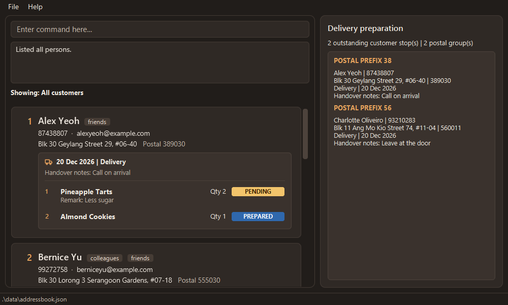

# LeBake User Guide

LeBake is a **desktop application for independent home bakers to manage customers and seasonal preorders**.
It keeps customer contact details, delivery addresses, and each customer's current preorder and fulfilment status
in one place.

LeBake is optimized for use through a **Command Line Interface (CLI)** while retaining the benefits of a
Graphical User Interface (GUI). Its text-based commands let you quickly add, find, and update customer and preorder
information.

<!-- * Table of Contents -->
<page-nav-print />

--------------------------------------------------------------------------------------------------------------------

## Quick start

1. Ensure that Java `25` or later is installed on your computer.<br>
   **Mac users:** Ensure you have the precise JDK version prescribed [here](https://se-education.org/guides/tutorials/javaInstallationMac.html).

1. Download the latest `.jar` file from the [LeBake releases page](https://github.com/AY2627S1-CS2103T-F09-3/tp/releases).

1. Copy the file to the folder you want to use as the _home folder_ for LeBake.

1. Open a terminal, `cd` to the folder containing the JAR file, and run `java -jar LeBake.jar`.<br>
   A GUI similar to the one below should appear in a few seconds. Note how the app contains some sample data.<br>
   

1. Type a command in the command box and press Enter to execute it. For example, type **`help`** and press Enter to open the help window.<br>
   Some example commands you can try:

   * `list` : Lists all contacts.

   * `add n/John Doe p/98765432 e/johnd@example.com a/John street, block 123, #01-01 c/123456` : Adds a contact named `John Doe` to LeBake.

   * `delete 3` : Deletes the 3rd contact shown in the current list.

   * `clear` : Deletes all contacts.

   * `exit` : Exits the app.

1. Refer to the [Features](#features) section below for details of each command.

--------------------------------------------------------------------------------------------------------------------

## Features

<box type="info" seamless>

**Notes about the command format:**<br>

* Words in `UPPER_CASE` are the parameters to be supplied by the user.<br>
  For example, in `add n/NAME`, replace `NAME` with a value such as `John Doe`.

* Items in square brackets are optional.<br>
  For example, `edit INDEX [n/NAME] [p/PHONE_NUMBER]` can be used as `edit 1 n/John Doe` or as `edit 1 p/91234567`.

* Prefixed parameters can be in any order, unless stated otherwise. A positional `INDEX` must appear before them.<br>
  For example, if the command specifies `n/NAME p/PHONE_NUMBER`, `p/PHONE_NUMBER n/NAME` is also acceptable.

* Extraneous parameters for commands that take no parameters, such as `help`, `list`, `exit`, and `clear`, are ignored.<br>
  For example, `help 123` is interpreted as `help`.

* If you are using a PDF version of this document, be careful when copying and pasting commands that span multiple lines as space characters surrounding line-breaks may be omitted when copied over to the application.
</box>

### How searches and updates affect the list

Search criteria determine which customers are displayed. Keeping the criteria preserves the search; the results still refresh when customer or preorder data changes.

| Commands | Effect on the current search |
|----------|------------------------------|
| `find`, `track` | Each successful command replaces the previous criteria and searches all stored customers. |
| `add`, `edit`, `delete`, `tag`, `untag`, `preorder`, `deleteorder` | Preserve the active criteria and refresh the matching results. |
| `list` | Clears the criteria and shows all customers. |

During a session, use `list` to explicitly return to an unfiltered view. A `find` that happens to match every customer still has active criteria. Empty results do not clear the criteria either. Updates and deletions can change the displayed indexes, so check them before your next command.

Examples, using the customer's current displayed `INDEX`:

| Search and update | Result |
|-------------------|--------|
| `track`, then `deleteorder INDEX` | The customer disappears from tracking because they no longer have a preorder. Their customer record remains saved. |
| `find n/Alice`, then `deleteorder INDEX` | Alice remains visible because her name still matches the search. |

Search criteria are not saved. Restarting the app begins with all saved customers displayed.

### Viewing help: `help`

Shows a window containing the [LeBake User Guide URL](https://ay2627s1-cs2103t-f09-3.github.io/tp/UserGuide.html).
Click **Copy URL** to copy the link to your clipboard.


Format: `help`


### Adding a person: `add`

Adds a person to the address book using their name, phone number, email address, address, and postal code.

Format: `add n/NAME p/PHONE_NUMBER e/EMAIL a/ADDRESS c/POSTAL_CODE`

Postal codes must contain exactly six digits. They are stored as text, so leading zeroes are preserved.

* All five fields (`n/`, `p/`, `e/`, `a/`, and `c/`) must be provided.
* Names must contain at least one English letter (`A-Z` or `a-z`) and may contain only English letters, spaces, straight apostrophes (`'`) and hyphens (`-`). Accented letters, non-English characters, digits and other symbols are rejected. For example, `Mary-Jane O'Brien`, `Li` and `A` are valid names; `José Tan` and `---` are invalid.
* Leading and trailing spaces are removed, and consecutive spaces become a single space. Capitalization is preserved. For example, `n/  Mary-Jane   O'Brien  ` is stored as `Mary-Jane O'Brien`.
* A person is a duplicate if their name matches an existing person's name after ignoring capitalization and normalizing spaces. For example, `John Doe`, `john doe` and `  JOHN   DOE  ` refer to the same name. Phone number, email, address and tags do not affect this check.
* Duplicate checks include all persons in the address book, even those hidden by a `find` command.
* New persons are added without tags or a preorder. Use [`tag`](#tagging-a-person-tag) to add tags afterwards.
* Adding preserves the current search criteria. The new person appears only if they match. For example, they stay hidden after a tag search or `track` because they have no tags or preorder yet. Use `list` to show all customers.


Examples:

* `add n/John Doe p/98765432 e/johnd@example.com a/John street, block 123, #01-01 c/123456`
* `add n/Betsy Crowe e/betsycrowe@example.com a/Newgate Prison p/81234567 c/654321`
* `add n/Mary-Jane O'Brien p/98765432 e/maryjane@example.com a/123 Baker Street c/123456`

### Listing all persons: `list`

Clears the current search criteria and postal-code grouping, and shows all persons in the address book in their saved order.

Format: `list`

### Editing a person: `edit`

Edits the name, phone number, email address, address, or postal code of an existing person in the address book.

Format: `edit INDEX [n/NAME] [p/PHONE_NUMBER] [e/EMAIL] [a/ADDRESS] [c/POSTAL_CODE]`

* Edits the person at the specified `INDEX`. The index refers to the index number shown in the displayed person list. The index **must be a positive integer** 1, 2, 3, ...
* At least one of `n/`, `p/`, `e/`, `a/`, or `c/` must be provided.
* Fields you provide replace their existing values. Fields you omit remain unchanged.
* The name validation and spacing rules described for `add` also apply to `edit`.
* You can retain a person's own name or change its capitalization or spacing while editing. A name matching another person's name is rejected, including persons hidden by a `find` command. Other contact details do not affect this duplicate check.
* Existing tags and preorders are always preserved.
* Editing preserves the current search criteria. A person disappears from the results if their edited details no longer match. Check the displayed indexes again before your next command, or use `list` to show all customers.

Examples:

*  `edit 1 p/91234567 e/johndoe@example.com` Edits the phone number and email address of the 1st person to be `91234567` and `johndoe@example.com` respectively.
*  `edit 2 n/Betsy Crower` Edits the name of the 2nd person to be `Betsy Crower`, preserving all other details and tags.
*  `edit 1 n/JOHN DOE` Changes the capitalization of the 1st person's name if they are already named `John Doe`.

### Tagging a person: `tag`

Adds a tag to an existing person, so you can group your customers (for example, `regular` or `vip`).

Format: `tag INDEX t/TAG`

* Adds the tag to the person at the specified `INDEX`. The index refers to the index number shown in the displayed person list. The index **must be a positive integer** 1, 2, 3, ...
* Only one tag can be added per command.
* A tag must be a single word made up of English letters and digits only (`A-Z`, `a-z`, `0-9`). Spaces, hyphens and other symbols are rejected. For example, `vip` and `Christmas2026` are valid; `gluten-free` and `big order` are invalid.
* Tags are case-insensitive: `VIP`, `Vip` and `vip` are the same tag. A tag keeps the capitalization it had when it was first added.
* If the person already has the tag, in any capitalization, their tags are left unchanged and a message tells you so.
* The person's other details, including their preorder, are not changed.
* The current list filter is preserved, and the change is saved automatically.

Examples:

* `tag 1 t/regular` adds the tag `regular` to the 1st person.
* `find n/Bernice` followed by `tag 1 t/vip` adds the tag `vip` to the 1st person in the results of the `find` command.
* `tag 1 t/FRIENDS` when the 1st person already has the tag `friends` shows a message that they already have the tag, and leaves their tags unchanged.
* If Alex Yeoh is displayed at index 1 and does not have the tag `VIP`, `tag 1 t/VIP` adds it and displays `Added tag(s) [VIP] to Alex Yeoh`.

Common errors:

| Input or situation | Feedback |
| --- | --- |
| `tag 0 t/VIP`, `tag -1 t/VIP`, or `tag abc t/VIP` | `Invalid command format!` followed by the tag usage instructions. |
| `tag`, `tag t/VIP`, or `tag 1` | `Invalid command format!` followed by the tag usage instructions. |
| `tag 1 t/`, `tag 1 t/big order`, or `tag 1 t/gluten-free` | `Tag names must not be blank and must contain only letters (A-Z, a-z) and digits (0-9), with no spaces or special characters. Examples: VIP, friends, regular123.` |
| `tag 1 t/VIP t/regular` | `Multiple values specified for the following single-valued field(s): t/` |
| `tag 5 t/VIP` when fewer than five persons are displayed, or any valid index when the list is empty | `The person index provided is invalid.` |
| `tag 1 t/VIP` when the first person is Alex Yeoh and already has the tag `vip` | `Alex Yeoh already has tag [VIP]. No changes made.` |

If several inputs are invalid, only the first detected error is shown. The index format is checked before the tag input; whether the index exists in the displayed list is checked after both inputs are valid.

### Removing a person's tag: `untag`

Removes an existing tag from a person in the currently displayed list.

Format: `untag INDEX t/TAG`

* `INDEX` must be a positive integer shown in the current list. After a `find` command, use the index shown in its search results.
* Supply exactly one `t/TAG`, after the index. The tag must not be blank and must contain only English letters (`A-Z`, `a-z`) and digits (`0-9`). Internal spaces and special characters are not allowed. Leading and trailing spaces are ignored.
* Matching is case-insensitive. For example, `t/vip` removes an existing `VIP` tag.
* Other tags, contact details, and any preorder remain unchanged. Removing the last tag leaves the person with no tags.
* The current list filter is preserved, and the change is saved automatically.
* If the command is rejected due to invalid or missing tags, no person's data is changed.

Examples:

* `untag 3 t/wholesale` removes the `wholesale` tag from the third person shown, provided they have that tag.
* `find n/Bernice` followed by `untag 1 t/friends` removes the `friends` tag from the first search result, provided that person has the tag.
* If Alex Yeoh is displayed at index 1 and has the tag `VIP`, `untag 1 t/vip` removes it and displays `Removed tag(s) [vip] from Alex Yeoh`.

Common errors:

| Input or situation | Feedback |
| --- | --- |
| `untag 0 t/VIP`, `untag -1 t/VIP`, or `untag abc t/VIP` | `Invalid command format!` followed by the untag usage instructions. |
| `untag`, `untag t/VIP`, or `untag 1` | `Invalid command format!` followed by the untag usage instructions. |
| `untag 1 t/`, `untag 1 t/close friends`, or `untag 1 t/VIP!` | `Tag names must not be blank and must contain only letters (A-Z, a-z) and digits (0-9), with no spaces or special characters. Examples: VIP, friends, regular123.` |
| `untag 1 t/VIP t/friends` | `Multiple values specified for the following single-valued field(s): t/` |
| `untag 5 t/VIP` when fewer than five persons are displayed, or any valid index when the list is empty | `The person index provided is invalid.` |
| `untag 1 t/VIP` when the first person is Alex Yeoh and has no `VIP` tag | `Alex Yeoh does not have tag [VIP]` |

If several inputs are invalid, only the first detected error is shown. The index format is checked before the tag input; whether the index exists in the displayed list is checked after both inputs are valid.

### Grouping customers by postal code: `group postal`

Groups the currently displayed customers by postal code without changing the saved customer order.

Format: `group postal`

* Customers are shown in ascending six-digit postal-code order, under headings based on their first two digits. Customers with the same postal code are ordered by name.
* Customers from old data files without postal codes remain usable and display `Postal code needed`. They appear in a final `MISSING POSTAL CODE` group.
* Grouping keeps the current filter, including results from `find` or `track`. It does not change customer details, preorders, or the order saved in the data file.
* Displayed index numbers follow the grouped list. Use those numbers for commands such as `edit`, `tag`, and `deleteorder`.
* Use `list` to show all customers in their saved order and remove the group headings. Grouping is not restored after restarting the application.
* This command does not calculate delivery routes or filter by fulfilment information.

For example, `find n/Alex` followed by `group postal` groups only the matching customers. To update the first displayed customer's postal code while preserving their other details and preorder, use `edit 1 c/012345`.

### Preparing deliveries

The **Delivery preparation** panel above the customer list summarises outstanding deliveries in the current results. It refreshes after searches, customer changes, and preorder changes. No extra command is needed. When there are no outstanding deliveries, the panel remains visible with zero totals and `No outstanding deliveries in the current results.`

* A customer counts as one outstanding stop when their preorder uses `DELIVERY` and has at least one `PENDING` or `PREPARED` item. Multiple items still count as one stop.
* Collection, empty preorders, completed-only preorders, and preorders without a method do not contribute to the totals.
* Contacts are grouped by the first two postal digits. Each contact shows their name, phone, address, complete postal code, fulfilment date, and handover notes.
* Customers without postal codes remain included under `MISSING POSTAL CODE`, which counts as one additional postal group. Their contact shows `Postal code needed`.
* An outstanding delivery without a date shows `Not scheduled`; absent handover notes show `Handover notes: None`.
* The contact area scrolls and wraps long text. Use Tab to focus it and the arrow keys to scroll.

For the sample data, `list` shows two outstanding delivery stops in two postal groups. `find f/2026-12-20 m/delivery` selects the deliveries for that date; `group postal` groups those results while keeping the search. An empty scheduled preorder may appear in the customer results but does not count as an outstanding stop.

### Finding customers by their attributes and preorder items: `find`

Finds customers matching **every** supplied criterion.

Format: `find [n/NAME] [p/PHONE] [e/EMAIL] [a/ADDRESS] [c/POSTAL_CODE_PREFIX] [t/TAG] [d/PRODUCT] [s/STATUS] [f/YYYY-MM-DD] [m/METHOD] [h/HANDOVER_NOTES]`

Supply at least one prefixed criterion. Each prefix may appear at most once, in any order. Name searches require `n/`.

| Prefix | Searches | Matching rule |
|--------|----------|---------------|
| `n/` | Customer name | Case-insensitive substring |
| `p/` | Phone number | Substring |
| `e/` | Email | Case-insensitive substring |
| `a/` | Address | Case-insensitive substring |
| `c/` | Postal code | Starts with the supplied one to six digits, preserving leading zeros |
| `t/` | Tag | Complete tag name, ignoring case |
| `d/` | Preorder item product name | Complete product name, ignoring case |
| `s/` | Item status | `PENDING`, `PREPARED` or `COMPLETED`, ignoring case |
| `f/` | Shared preorder fulfilment date | Exact real date in `YYYY-MM-DD` format |
| `m/` | Shared preorder method | `delivery` or `collection`, ignoring case |
| `h/` | Shared preorder handover notes | Case-insensitive substring |

* Different criteria combine using **AND**. For example, `find n/Alice t/regular` requires both a matching name and the complete tag `regular`.
* Names support partial matching: `find n/Han` can match `Hans Gruber`.
* Multiword text is one substring: `find n/Alice Tan` can match `Alice Tanaka`, but does not match `Alice Lim` or `Tan Alice`.
* Surrounding whitespace is ignored. Internal spacing and punctuation remain significant.
* Phone and email fragments are accepted: `p/8123` and `e/example.com` need not be complete contact details.
* Postal searches accept one to six digits. `find c/53` matches codes beginning with `53`, such as `530123` and `531234`; `find c/530` narrows this to codes beginning with `530`. A six-digit query such as `find c/012345` matches only that complete code. Customers without a postal code do not match a postal-code criterion.
* When adding a customer or editing their postal code, supply all six digits. Shorter prefixes are accepted only for searching; leading zeros are preserved in both cases.
* Tags must be single alphanumeric words. `t/reg` does not match a tag named `regular`.
* Fulfilment conditions check the preorder's shared information. They can find empty preorders; customers without a preorder or without the requested field do not match. Handover notes are separate from an individual item's request notes.
* Product names match completely: `find d/PINEAPPLE TARTS` matches `Pineapple Tarts`, but `find d/Pineapple` does not. Surrounding whitespace is ignored; internal spacing and punctuation remain significant.
* Omitting `s/` includes **all statuses**, including `COMPLETED`. A blank `s/` is invalid. A status-only search such as `find s/prepared` accepts any product with that status.
* Product and status must match the **same item**. A customer with pending Pineapple Tarts and prepared Almond Cookies does not match `find d/Pineapple Tarts s/prepared`.
* Customers without a preorder or with an empty preorder cannot match item criteria. Customer-only searches can still find them.
* All items on matching customer cards remain visible with their existing item numbers, including items that did not match. Searches do not change stored items.
* Every new `find` searches all stored customers and replaces the previous search, including a previous `track` filter. Consecutive searches do not accumulate criteria.
* Results use the current displayed indices. Use `list` to show all customers again.
* Use lowercase prefixes. A prefix starts at the beginning of the arguments or after whitespace. Unknown letter-based prefixes such as `x/` are rejected; embedded slashes such as `#04/08` remain ordinary text.

Examples:

* `find n/Alice Tan` finds names containing the phrase `Alice Tan`.
* `find p/8123` finds phone numbers containing `8123`.
* `find e/example.com` finds emails containing `example.com`.
* `find c/53` finds customers whose postal code starts with `53`.
* `find c/01` finds customers whose postal code starts with `01`, including `012345`.
* `find c/123456` finds customers whose postal code is exactly `123456`.
* `find n/Alice c/53` requires both a name containing `Alice` and a postal code starting with `53`.
* `find a/Hougang t/regular` finds regular customers whose addresses contain `Hougang`.
* `find n/Alice p/8123 t/regular` requires all three criteria to match.
* `find f/2026-12-20 m/delivery` finds delivery preorders scheduled for that date, including ones without items.
* `find n/Alice m/collection h/side gate` requires a matching name, collection method, and handover notes containing `side gate`.
* `find c/53 f/2026-12-20 m/delivery h/arrival` combines a postal prefix with the shared date, method, and handover notes.
* `find d/Pineapple Tarts` finds customers with that product in any status.
* `find n/Alice d/Pineapple Tarts s/pending` finds customers whose names contain Alice and who have a pending Pineapple Tarts item.

Customer and preorder changes preserve the search and refresh the results. A customer disappears when their last matching item is removed or stops matching. Displayed customer indexes can change, so check them before the next command.

**Invalid inputs**

| Input | Result |
|-------|--------|
| `find` or `find Alice Bob` | Invalid command format; supply at least one prefixed criterion. |
| `find n/`, `find c/` or `find n/Alice p/` | Invalid command format; every supplied prefix needs a value. |
| `find x/Alice` or `find o/Pineapple Tarts` | Invalid command format; only the eleven prefixes above are supported. |
| `find Alice m/delivery` | Invalid command format; use `find n/Alice m/delivery`. |
| `find f/2026-02-30` or `find f/2026-2-03` | The date constraint message is shown; supply a real date in `YYYY-MM-DD` format. |
| `find m/pickup` | `Invalid method! Method must be DELIVERY or COLLECTION.` |
| `find h/` or `find m/` | Invalid command format; every supplied prefix needs a value. |
| `find s/unknown` | The item-status constraint message is shown. |
| `find d/Tarts d/Cookies` or `find s/pending s/prepared` | Repeated single-valued prefixes are rejected. |
| `find c/1234567`, `find c/01234a` or `find c/5 3` | `Postal-code search values must contain one to six digits.` |
| `find c/012345 c/123456` | `Multiple values specified for the following single-valued field(s): c/` |
| `find t/regular t/vip` | `Multiple values specified for the following single-valued field(s): t/` |
| `find t/regular customer` or `find t/VIP!` | The tag constraint message is shown. |

Rejected searches leave the current criteria and results unchanged. If no customers match a valid search, the list is empty and the feedback reports `0 person(s) listed!`. Use `list` to clear the search.

### Adding a preorder item: `additem`

Adds one item to a customer's preorder. If the customer has no preorder, one is created automatically.

Format: `additem INDEX d/NAME q/QUANTITY s/STATUS [r/REMARK]`

* `INDEX` is a positive integer identifying a customer in the **currently displayed list**.
* Name, quantity and status are required. A name must be non-blank, on one line and at most 200 characters long.
* Quantity must be a whole number from 1 to 999, without leading zeros.
* Status must be `PENDING`, `PREPARED` or `COMPLETED`, ignoring capitalisation.
* Remarks are optional. If supplied, a remark must be non-blank, on one line and at most 100 characters long.
* Surrounding spaces in values are trimmed. Prefixes may appear in any order, but each can appear only once.
* The item is appended to the preorder. Repeated product names, including identical items, remain separate entries.
* Existing items, contact details and tags are preserved. The current filter remains active.

Example: `additem 1 d/Cake q/2 s/pending r/Less sugar`

If customer 1 is Alice and this is her first item, the success message is:
`Added item 1 for Alice: Cake (quantity: 2, PENDING)`.
The remark appears on the customer card, rather than in the success message.

Omitting a required prefix displays `Invalid command format!` followed by usage instructions.
Supplying an empty value displays that field's validation error. In particular, `r/` without text is invalid when adding.
An index beyond the displayed customer list produces `The person index provided is invalid.`

### Editing a preorder item: `edititem`

Edits one numbered item, preserving omitted fields and all other items.

Format: `edititem INDEX i/ITEM_INDEX [d/NAME] [q/QUANTITY] [s/STATUS] [r/REMARK]`

* `INDEX` identifies a customer in the currently displayed list. `ITEM_INDEX` identifies an item by the number on that
  customer's card. Both must be positive integers.
* At least one edit field must be supplied. Names, quantities, statuses and non-empty remarks follow the rules for `additem`.
* Omitted fields retain their values. An empty `r/` **clears** the remark; omitting `r/` preserves it.
* An item migrated from v1.3 keeps its missing quantity until a valid `q/QUANTITY` is supplied.
* Supplying an existing value is accepted and reports success, even if the item does not change.
* Other items, contact details and tags are preserved. The current filter remains active. Changing an item's status can
  remove its customer from a tracked view, so check the displayed customer indices before the next command.

Examples:

* `edititem 1 i/2 q/3` changes the quantity of customer 1's second item.
* `edititem 1 i/2 s/prepared` changes only that item's status.
* `edititem 1 i/2 r/` clears only that item's remark.

For Alice's second item, Cake, the success message could be:
`Edited item 2 for Alice: Cake (quantity: 3, PREPARED)`.
If its quantity is still missing, the message uses the same wording as the card:
`Edited item 2 for Alice: Cake (quantity needed, PREPARED)`.
The card continues to display `quantity needed` for that item.

| Situation | Message |
|-----------|---------|
| No edit fields, e.g. `edititem 1 i/2` | `No item changes specified.` |
| Customer has no preorder | `Identified person has no preorder.` |
| Preorder is empty or item number exceeds the item count | `The item index provided is invalid.` |
| Customer index exceeds the displayed list | `The person index provided is invalid.` |
| Missing or malformed customer index, or missing `i/` prefix | `Invalid command format!` followed by usage instructions |
| Present but empty or invalid item index, e.g. `i/0` or `i/abc` | `Item index must be a positive integer.` |

For both commands, repeated prefixes produce `Multiple values specified for the following single-valued field(s): `
followed by the repeated prefixes. Input validation reports the first error: customer-index syntax, duplicate prefixes,
required fields/item-index syntax, then name, quantity, status and remark values. Customer and item existence are checked
only after parsing succeeds. An edit with no supplied changes is rejected before those existence checks.
Validation failures leave the data unchanged. The former `order` command is no longer supported.

### Viewing preorders: `track`

Format: `track [s/STATUS]`

* `track` shows customers with at least one active item (`PENDING` or `PREPARED`) in their preorder.
* `track s/COMPLETED` shows customers with at least one `COMPLETED` item. You can also filter by `PENDING` or `PREPARED`; status input is case-insensitive.
* Each successful `track` searches all customers and replaces the previous `find` or `track` criteria. Rejected commands preserve the current criteria and results.
* Customers without preorders, or whose preorder has no items yet, are excluded. Use `list` to show all customers again.

`track` accepts only the optional `s/` field. Use `find` for product or customer combinations. `track s/prepared` and `find s/prepared` select the same customers. Bare `track` includes only active statuses, whereas `find d/Pineapple Tarts` includes all statuses.

Feedback distinguishes customers from matching item entries. For example, one customer with two pending items and another with one pending item produces `2 customer(s) with 3 matching item(s) for PENDING listed!`. Each customer counts once; repeated product entries count separately. Quantities are not added to this count, and an item with a missing quantity still counts as one item. With no matches, `track s/pending` reports `0 customer(s) with 0 matching item(s) for PENDING listed!`.

A customer's preorder appears in a dark panel at the bottom of their card. Its first line shows when and how the preorder will be handed over, for example `20 Dec 2026 | Delivery`. A date that is not recorded yet shows as `Not scheduled`, and a method as `Method not set`. Any handover notes appear on the next line, for example `Handover notes: Call on arrival`. Below them, each item has its own row with its number and name, its quantity and its status, for example `1. Pineapple Tarts`, `Qty 2` and `PENDING`. A special request appears under the item, for example `Remark: Less sugar`, and a preorder with no items shows `No items yet`. The status badge's colour shows the status:

Status | Meaning | Badge colour
-------|---------|-------------
`PENDING` | Recorded but not ready | Amber
`PREPARED` | Ready for collection or delivery | Blue
`COMPLETED` | Collected or delivered | Green

If you used LeBake v1.3, each saved preorder appears as one item with the same details and status. v1.3 did not record quantities, so these items show `quantity needed` instead of a quantity.

### Deleting a preorder item: `deleteitem`

Deletes one item from a customer's preorder, for example when the customer cancels a product, while keeping the customer and the remaining items.

Format: `deleteitem INDEX i/ITEM_INDEX`

* `INDEX` must be a positive integer referring to a customer in the **currently displayed list**, including results of `find` or `track`.
* `ITEM_INDEX` must be a positive integer referring to the item number shown on that customer's card. It refers to the customer's full item list.
* Only the selected item is removed. Remaining items keep their relative order and are renumbered from 1. Identical items remain separate: deleting one does not delete the others.
* Deleting the final item retains an **empty preorder**. The customer's name, phone number, email, address, postal code and tags are unchanged. The preorder's fulfilment date, method and handover notes are also preserved.
* Both indices are required. The `i/` prefix must appear exactly once; `o/` is not accepted for item selection.
* Deletion cannot be undone through the app.
* The current filter is preserved. A customer may disappear from a tracked view if no remaining item matches it. Check the displayed customer and item numbers before your next command. Use `list` to show all customers again.

For example, deleting Alex Yeoh's second sample item shows:

```text
Deleted item 2 for Alex Yeoh: Almond Cookies (quantity: 1, PREPARED)
```

The message uses the item's number before deletion. For a migrated item with no recorded quantity, the quantity value is blank, for example `(quantity: , PENDING)`.

| Situation | Message |
|-----------|---------|
| Customer index exceeds the displayed list | `The person index provided is invalid.` |
| Customer has no preorder | `Identified person has no preorder.` |
| Preorder is empty or item index exceeds the item count | `The item index provided is invalid.` |
| Missing or invalid customer index, or missing `i/` prefix | `Invalid command format!` followed by usage instructions |
| Present but empty or invalid item index, e.g. `i/0` or `i/abc` | `Item index must be a positive integer.` |
| Repeated `i/` prefix | `Multiple values specified for the following single-valued field(s): i/` |

Validation failures leave the data unchanged. If several inputs are invalid, customer-index syntax is checked first, then duplicate prefixes, then item-index syntax. Customer, preorder and item existence are checked after parsing succeeds.

Examples:

* `deleteitem 1 i/2` deletes the second item of the first displayed customer.
* `find n/Bernice` followed by `deleteitem 1 i/1` deletes the first item of the first matching customer.
* `track` followed by `deleteitem 1 i/1` deletes the first item of the first displayed customer, whether or not that particular item is active.

### Setting delivery or collection details: `preorder`

Records when and how a customer receives their preorder, plus a short note for the handover. These details are shared by **every item** in the customer's preorder, so you set them once per customer rather than once per item.

Format: `preorder INDEX [f/DATE] [m/METHOD] [h/HANDOVER_NOTES]`

| Prefix | Detail | Rules |
|--------|--------|-------|
| `f/` | Fulfilment date: the day of delivery or collection | A real calendar date in `YYYY-MM-DD` format, e.g. `2026-12-20` |
| `m/` | Method | `delivery` or `collection`, in any capitalisation |
| `h/` | Handover notes, e.g. `Call on arrival` or `Collect from side gate` | One line of at most 100 characters |

* `INDEX` is a positive integer identifying a customer in the **currently displayed list**, including results of `find` or `track`.
* Supply at least one of `f/`, `m/` and `h/`, in any order. Each can appear only once.
* Only the details you supply change. For example, `preorder 1 m/collection` changes the method and keeps the date and handover notes.
* A prefix with no value **clears** that detail. For example, `preorder 1 h/` removes the handover notes and `preorder 1 f/ m/ h/` clears all three.
* If the customer has no preorder yet, supplying at least one nonempty value creates one with no items, so you can record the arrangements before adding items with [`additem`](#adding-a-preorder-item-additem). Supplying only empty values makes no changes because there is nothing to clear.
* A past date is accepted, so you can still record late orders. The success message then adds a note on a new line, for example `Note: 20 Dec 2025 is in the past.`
* The customer's items (with their quantities, statuses and remarks), contact details, postal code and tags are not changed. The current filter remains active.
* Surrounding spaces in values are trimmed. Text that starts a new prefix after a space, such as ` m/`, ends the previous value, so avoid it inside handover notes.

On success, the app shows the customer's details after the change, for example:
`Updated preorder details for Alex Yeoh: Date: 21 Dec 2026 | Method: COLLECTION | Handover notes: Collect from side gate`.
A detail that is not set is shown as `Date: Not scheduled`, `Method: Not set` or `Handover notes: None`.

Examples, using the sample data:

* `preorder 1 f/2026-12-21 m/collection h/Collect from side gate` changes Alex Yeoh's preorder to a collection on 21 Dec 2026, keeping the two items already in it.
* `preorder 5 f/2026-12-24 m/delivery` creates a preorder with no items for Irfan Ibrahim and shows `Updated preorder details for Irfan Ibrahim: Date: 24 Dec 2026 | Method: DELIVERY | Handover notes: None`.
* `preorder 2 h/` clears Bernice Yu's handover notes and keeps the date and method.

Common errors:

| Input or situation | Feedback |
| --- | --- |
| `preorder 1` | `At least one of f/DATE, m/METHOD or h/HANDOVER_NOTES must be provided.` |
| `preorder 1 f/2026-02-30` or `preorder 1 f/20-12-2026` | `Invalid date! Dates must be real calendar dates in YYYY-MM-DD format, e.g. 2026-12-20.` |
| `preorder 1 m/pickup` | `Invalid method! Method must be DELIVERY or COLLECTION.` |
| Handover notes longer than 100 characters | `Invalid handover notes! Handover notes must not be blank, must be on a single line, and must be at most 100 characters long.` |
| `preorder 1 f/2026-12-20 f/2026-12-21` | `Multiple values specified for the following single-valued field(s): f/` |
| `preorder`, `preorder 0 m/delivery`, `preorder abc m/delivery`, `preorder 1 2 m/delivery`, or a prefix of another command such as `preorder 1 d/Cake` | `Invalid command format!` followed by the preorder usage instructions. |
| `preorder 7 m/delivery` when fewer than seven customers are displayed | `The person index provided is invalid.` |
| `preorder 6 h/` when Roy Balakrishnan has no preorder | `Roy Balakrishnan has no preorder, so there is nothing to clear. No changes made.` |

If several inputs are invalid, only the first detected error is shown, in this order: the index format, repeated prefixes, the date, method and handover notes values, then the missing details. Whether the index exists in the displayed list is checked last.

### Deleting a preorder: `deleteorder`

Deletes a customer's current preorder, for example when the customer cancels, while keeping them as a customer.

Format: `deleteorder INDEX`

* `INDEX` must be a positive integer referring to a customer in the **currently displayed list**, including results of `find` or `track`.
* The whole preorder is removed, including all its items. The customer's name, phone number, email, address and tags are not changed.
* If the customer has no preorder, nothing is changed and the app shows `NAME has no preorder to delete.`, for example `Alex Yeoh has no preorder to delete.`
* If `INDEX` is larger than the displayed list, the app shows `The person index provided is invalid.`
* A deleted preorder cannot be restored.
* Deleting a preorder keeps the current filter. After `track`, the customer no longer has a preorder, so they disappear from that view. Check the displayed indices again before your next command. Use `list` to show all customers.

On success, the app shows whose preorder was deleted, for example `Deleted preorder for Alex Yeoh`.

Examples:

* `track` followed by `deleteorder 1` deletes the preorder of the 1st customer in the results of the `track` command.
* `find n/Bernice` followed by `deleteorder 1` deletes the preorder of the 1st customer in the results of the `find` command.

### Deleting a person: `delete`

Deletes the specified person from the address book.

Format: `delete INDEX`

* Deletes the person at the specified `INDEX`.
* The index refers to the index number shown in the displayed person list.
* The index **must be a positive integer** 1, 2, 3, ...
* Deleting preserves the active search criteria. The remaining results refresh, and their displayed indexes may change.

Examples:
* `list` followed by `delete 2` deletes the 2nd person in the address book.
* `find n/Betsy` followed by `delete 1` deletes the 1st person in the results of the `find` command.

### Clearing all entries: `clear`

Clears all entries from the address book.

Format: `clear`

### Exiting the program: `exit`

Exits the program.

Format: `exit`

### Saving the data

LeBake automatically saves data after every successful command. You do not need to save manually.

### Editing the data file

LeBake data is saved automatically as a JSON file `[JAR file location]/data/addressbook.json`. Advanced users are welcome to update data directly by editing that data file.

Names in the data file follow the same validation and duplicate rules as `add` and `edit`. Extra spaces are normalized when the file is loaded. A file containing names without an English letter, names with unsupported characters (including accented letters and non-English characters), or duplicate names that differ only in capitalization or extra spaces, cannot be loaded. This also applies to data saved by earlier versions.

<box type="warning" seamless>

**Caution:**
If your changes make the data file invalid, LeBake starts with an empty address book at the next run. The invalid file remains on disk until you run a command (LeBake saves after every command). Still, we recommend backing up the file before editing it.<br>
Furthermore, certain edits can cause LeBake to behave in unexpected ways (e.g., if a value entered is outside of the acceptable range). Therefore, edit the data file only if you are confident that you can update it correctly.
</box>

### Archiving data files `[coming in v2.0]`

_Details coming soon ..._

--------------------------------------------------------------------------------------------------------------------

## FAQ

**Q**: How do I transfer my data to another computer?<br>
**A**: Install the app on the other computer and overwrite the data file it creates with the data file from your previous LeBake home folder.

--------------------------------------------------------------------------------------------------------------------

## Known issues

1. **When using multiple screens**, if you move the application to a secondary screen, and later switch to using only the primary screen, the GUI will open off-screen. The remedy is to delete the `preferences.json` file created by the application before running the application again.
2. **If you minimize the Help Window** and then run the `help` command (or use the `Help` menu, or the keyboard shortcut `F1`) again, the original Help Window will remain minimized, and no new Help Window will appear. The remedy is to manually restore the minimized Help Window.

--------------------------------------------------------------------------------------------------------------------

## Command summary

Action     | Format, Examples
-----------|----------------------------------------------------------------------------------------------------------------------------------------------------------------------
**Add**    | `add n/NAME p/PHONE_NUMBER e/EMAIL a/ADDRESS c/POSTAL_CODE` <br> e.g., `add n/James Ho p/92224444 e/jamesho@example.com a/123, Clementi Rd, 1234665 c/123456`
**Add item** | `additem INDEX d/NAME q/QUANTITY s/STATUS [r/REMARK]`<br> e.g., `additem 1 d/Cake q/2 s/pending`
**Edit item** | `edititem INDEX i/ITEM_INDEX [d/NAME] [q/QUANTITY] [s/STATUS] [r/REMARK]`<br> e.g., `edititem 1 i/2 q/3`
**Clear**  | `clear`
**Delete** | `delete INDEX`<br> e.g., `delete 3`
**Delete item** | `deleteitem INDEX i/ITEM_INDEX`<br> e.g., `deleteitem 1 i/2`
**Delete order** | `deleteorder INDEX`<br> e.g., `deleteorder 1`
**Edit**   | `edit INDEX [n/NAME] [p/PHONE_NUMBER] [e/EMAIL] [a/ADDRESS] [c/POSTAL_CODE]`<br> e.g.,`edit 2 n/James Lee e/jameslee@example.com`
**Find**   | `find [n/NAME] [p/PHONE] [e/EMAIL] [a/ADDRESS] [c/POSTAL_CODE_PREFIX] [t/TAG] [d/PRODUCT] [s/STATUS] [f/YYYY-MM-DD] [m/METHOD] [h/HANDOVER_NOTES]` (at least one prefixed criterion)<br> e.g., `find c/53 f/2026-12-20 m/delivery`
**Group postal** | `group postal`
**Track**  | `track [s/STATUS]`<br> e.g., `track s/PREPARED`
**List**   | `list`
**Preorder** | `preorder INDEX [f/DATE] [m/METHOD] [h/HANDOVER_NOTES]`<br> e.g., `preorder 1 f/2026-12-20 m/delivery h/Call on arrival`
**Tag**    | `tag INDEX t/TAG`<br> e.g., `tag 1 t/regular`
**Untag**  | `untag INDEX t/TAG`<br> e.g., `untag 1 t/friends`
**Help**   | `help`
