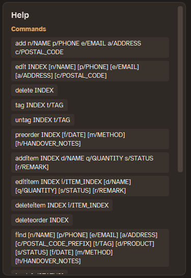
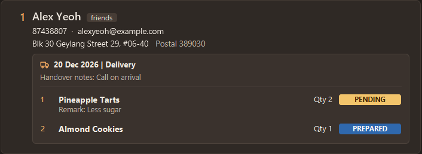

# LeBake User Guide

LeBake is a **desktop application for independent home bakers to manage customers and seasonal preorders**.
It keeps customer contact details, delivery addresses, and each customer's current preorder in one place.

LeBake is optimized for use through a **Command Line Interface (CLI)** while retaining the benefits of a
Graphical User Interface (GUI). Its text-based commands let you quickly add, find, and update customer and preorder
information.

<!-- * Table of Contents -->
<page-nav-print />

--------------------------------------------------------------------------------------------------------------------

## Quick start

1. Ensure that Java `25` or later is installed on your computer.<br>
   **Mac users:** Ensure you have the precise JDK version prescribed [here](https://se-education.org/guides/tutorials/javaInstallationMac.html).

1. Download the latest `.jar` file from the [LeBake releases page](https://github.com/AY2627S1-CS2103T-F09-3/tp/releases).

1. Copy the file to the folder you want to use as the _home folder_ for LeBake.

1. Open a terminal, `cd` to the folder containing the JAR file, and run `java -jar LeBake.jar`.<br>
   LeBake saves its data to `data/lebake.json` inside the terminal's current folder, so always start it from the home folder.<br>

   A GUI similar to the one below should appear. On your first launch, LeBake displays sample data.<br>
   

1. Type a command in the command box and press Enter to execute it. For example, type **`help`** and press Enter to show help in the side panel.<br>
   Some example commands you can try:

   * `list` : Lists all customers.

   * `add n/John Doe p/98765432 e/johnd@example.com a/John street, block 123, #01-01 c/123456` : Adds a customer named `John Doe` to LeBake.

   * `delete 3` : Deletes the 3rd customer shown in the current list.

   * `clear` : Starts a confirmation prompt; deletes all customers and preorder data after confirmation.

   * `exit` : Exits the app.

1. Refer to the [Features](#features) section below for details of each command.

--------------------------------------------------------------------------------------------------------------------

## Features

<box type="info" seamless>

**Notes about the command format:**<br>

* Words in `UPPER_CASE` are the parameters to be supplied by the user.<br>
  For example, in `add n/NAME`, replace `NAME` with a value such as `John Doe`.

* Items in square brackets are optional.<br>
  For example, `edit INDEX [n/NAME] [p/PHONE_NUMBER]` can be used as `edit 1 n/John Doe` or as `edit 1 p/91234567`.

* Prefixed parameters can be in any order, unless stated otherwise. A positional `INDEX` must appear before them.<br>
  For example, if the command specifies `n/NAME p/PHONE_NUMBER`, `p/PHONE_NUMBER n/NAME` is also acceptable.

* A supported prefix after whitespace starts another parameter and ends the previous value.<br>
  For example, `edititem 1 i/1 r/Less sugar s/pending` sets the remark to `Less sugar` and the status to `PENDING`.
  Quotation marks do not escape a supported prefix. Conventional `c/o` text is preserved inside addresses.

* Item names, remarks and handover notes reject forward slashes. Addresses allow ordinary slash notation such as
  `#04/08` and conventional `c/o`, but reject a letter-based token followed by `/` at the start or after whitespace,
  such as `s/pending` or `x/foo`.

* Character limits also apply to emoji in addresses, item names, remarks and handover notes. An emoji such as 🍰 counts as two characters; some emoji count as more.

* Extraneous parameters for commands that take no parameters, such as `help`, `list`, `exit`, and `clear`, are ignored.<br>
  For example, `help 123` is interpreted as `help`.

* If you are using a PDF version of this document, be careful when copying and pasting commands that span multiple lines as space characters surrounding line-breaks may be omitted when copied over to the application.
</box>

### How searches and updates affect the list

Search criteria determine which customers are displayed. Keeping the criteria preserves the search; the results still refresh when customer or preorder data changes.

| Commands | Effect on the current search |
|----------|------------------------------|
| `find`, `track` | Each successful command replaces the previous criteria and searches all stored customers. |
| `add`, `edit`, `delete`, `tag`, `untag`, `preorder`, `deleteorder` | Preserve the active criteria and refresh the matching results. |
| `sort date`, `group postal` | Preserve the active criteria and reorder the displayed results. A later `find` or `track` keeps this order. |
| `clear` | Clears the criteria, sorting and grouping, then leaves the list empty. |
| `list` | Clears the criteria, sorting and grouping, and shows all customers in their saved order. |

During a session, use `list` to explicitly return to an unfiltered view. A `find` that happens to match every customer still has active criteria. Empty results do not clear the criteria either. Updates and deletions can change the displayed indexes, so check them before your next command.

Examples, using the customer's current displayed `INDEX`:

| Search and update | Result |
|-------------------|--------|
| `track`, then `deleteorder INDEX` | The customer disappears from tracking because they no longer have a preorder. Their customer record remains saved. |
| `find n/Alice`, then `deleteorder INDEX` | Alice remains visible because her name still matches the search. |

Search criteria are not saved. Restarting the app begins with all saved customers displayed.

The area immediately above the customer list shows your active search:

* With no search criteria, it shows **Showing: All customers**.
* After `find` or `track`, it shows **Filters · Match all**, with a separate read-only badge for each criterion.
  For example, `find n/Alice t/regular` shows **Name: alice** and **Tag: regular**.
* Postal searches show the supplied digits, including leading zeros: `find c/01` shows **Postal: 01** and
  `find c/012345` shows **Postal: 012345**. Postal badges appear after Address and before Tag badges.
* Product and status conditions stay together: `find d/Pineapple Tarts s/pending` shows
  **Item: Pineapple Tarts · Pending** in one badge. `find d/Pineapple Tarts` shows
  **Item: Pineapple Tarts · Any status**, including completed items.
* A status-only search such as `find s/prepared` shows **Item status: Prepared**.
* `track` shows **Item status: Pending or Prepared** in one badge. `track s/PENDING` shows **Item status: Pending**.
* Date, method and handover-note searches have separate badges. For example,
  `find f/2026-10-22 m/delivery h/arrival` shows **Date: 22 Oct 2026**, **Method: Delivery** and
  **Handover notes: arrival**.

Badges use this order: Name, Phone, Email, Address, Postal, Tag, Item (or Item status), Date, Method and Handover notes.

The badges describe the search even when it matches every customer or no customers. Customer text searches show the
case-normalized query used for matching, while product searches preserve the capitalization you typed. All badges
and their full values remain available: badges wrap onto
additional rows, and long values wrap within a badge as you resize the window. They do not need to be clicked or
hovered over. Search updates leave keyboard focus in the command box, so you can enter your next command immediately.
Use `list` to clear the badges and return to **Showing: All customers**.

### Viewing help: `help`

Shows the format of every command and the [LeBake User Guide URL](https://ay2627s1-cs2103t-f09-3.github.io/tp/UserGuide.html) in the side panel, on the right of the window. Click **Copy URL** to copy the link to your clipboard. Help stays in the side panel until you run your next command. Pressing F1 or choosing **Help** from the menu also shows it.

Format: `help`



### Adding a customer: `add`

Adds a customer to LeBake using their name, phone number, email address, address, and postal code.

Format: `add n/NAME p/PHONE_NUMBER e/EMAIL a/ADDRESS c/POSTAL_CODE`

Postal codes must contain exactly six digits. They are stored as text, so leading zeroes are preserved.

* All five fields (`n/`, `p/`, `e/`, `a/`, and `c/`) must be provided.
* Names, emails and addresses allow at most 100, 254 and 300 characters respectively, after surrounding spaces are removed.
* Names must contain at least one English letter (`A-Z` or `a-z`) and may contain only English letters, spaces, straight apostrophes (`'`) and hyphens (`-`). Accented letters, non-English characters, digits and other symbols are rejected. For example, `Mary-Jane O'Brien`, `Li` and `A` are valid names; `José Tan` and `---` are invalid.
* Leading and trailing spaces are removed, and consecutive spaces become a single space. Capitalization is preserved. For example, `n/  Mary-Jane   O'Brien  ` is stored as `Mary-Jane O'Brien`.
* Name, phone, email and postal code values are validated first. An invalid value containing an extra unsupported prefix identifies that prefix. For example, adding `x/foo` after `p/98765432` shows `Unsupported prefix 'x/' for add.` Other invalid values keep their field constraint messages.
* Addresses allow conventional `c/o` and ordinary slash notation such as `#04/08`. A letter-based token followed by
  `/` at the start or after whitespace, such as `s/pending`, is rejected so it cannot be confused with another field.
* A customer is a duplicate if their name matches an existing customer's name after ignoring capitalization and normalizing spaces. For example, `John Doe`, `john doe` and `  JOHN   DOE  ` refer to the same name. Phone number, email, address and tags do not affect this check.
* Duplicate checks include all saved customers, even those hidden by a `find` command.
* New customers are added without tags or a preorder. Use [`tag`](#tagging-a-customer-tag) to add tags afterwards.
* Adding preserves the current search criteria. The new customer appears only if they match. For example, they stay hidden after a tag search or `track` because they have no tags or preorder yet. Use `list` to show all customers.


Examples:

* `add n/John Doe p/98765432 e/johnd@example.com a/John street, block 123, #01-01 c/123456`
* `add n/Betsy Crowe e/betsycrowe@example.com a/Newgate Prison p/81234567 c/654321`
* `add n/Mary-Jane O'Brien p/98765432 e/maryjane@example.com a/123 Baker Street c/123456`

Success feedback begins with `New customer added:`, followed by the customer's details.

With the sample data, `add n/alex yeoh p/91234567 e/alex2@example.com a/1 Test Road c/123456` is rejected with:

`A customer named "alex yeoh" already exists. Customer names must be unique (ignoring capitalisation and extra spaces). Choose a different name.`

The message uses the name you supplied, with surrounding spaces removed, repeated spaces collapsed to one,
and capitalization preserved.
The saved customer, current search criteria and displayed results remain unchanged.

### Listing all customers: `list`

Clears the current search criteria, sorting and postal-code grouping, and shows all saved customers in their saved order.

Format: `list`

Feedback: `Listed all customers.`

### Editing a customer: `edit`

Edits the name, phone number, email address, address, or postal code of an existing customer.

Format: `edit INDEX [n/NAME] [p/PHONE_NUMBER] [e/EMAIL] [a/ADDRESS] [c/POSTAL_CODE]`

* Edits the customer at the specified `INDEX`. The index refers to the index number shown in the displayed customer list. The index **must be a positive integer** 1, 2, 3, ...
* At least one of `n/`, `p/`, `e/`, `a/`, or `c/` must be provided.
* Fields you provide replace their existing values. Fields you omit remain unchanged.
* The same field validation, length limits and spacing rules as [`add`](#adding-a-customer-add) apply to `edit`.
* You can retain a customer's own name or change its capitalization or spacing while editing. A name matching another customer's name is rejected, including customers hidden by a `find` command. Other contact details do not affect this duplicate check.
* Existing tags and preorders are always preserved.
* Editing preserves the current search criteria. A customer disappears from the results if their edited details no longer match. Check the displayed indexes again before your next command, or use `list` to show all customers.

An unsupported letter-based prefix after whitespace in an invalid `n/`, `p/`, `e/` or `c/` value is named directly.
For example, `edit 1 p/91234567 x/foo` displays `Unsupported prefix 'x/' for edit.` Remove the unsupported argument
and try again. Ordinary invalid values keep their corresponding field constraint messages.

Addresses allow conventional `c/o` and ordinary slash notation such as `#04/08`. A letter-based token followed by `/`
at the start or after whitespace, such as `s/pending`, is rejected. Customer names follow the existing name validation
rules described for `add`.

Examples:

*  `edit 1 p/91234567 e/johndoe@example.com` Edits the phone number and email address of the 1st customer to be `91234567` and `johndoe@example.com` respectively.
*  `edit 2 n/Betsy Crower` Edits the name of the 2nd customer to be `Betsy Crower`, preserving all other details and tags.
*  `edit 1 n/JOHN DOE` Changes the capitalization of the 1st customer's name if they are already named `John Doe`.

If several inputs are invalid, checks run in this order: index format, duplicate prefixes, then name, phone, email,
address and postal code. Whether the index exists in the displayed list is checked after the supplied fields are valid.
Rejected edits leave customer data and the current filter unchanged.

Success feedback begins with `Edited customer:`, followed by the customer's updated details.

With the sample data, `edit 2 n/alex yeoh` is rejected with the same duplicate-name message as `add`:

`A customer named "alex yeoh" already exists. Customer names must be unique (ignoring capitalisation and extra spaces). Choose a different name.`

The message shows the supplied name after space normalization, preserving its capitalization. Choose a name that
does not match another saved customer. Changing only the capitalization of the customer's own name is allowed.

### Tagging a customer: `tag`

Adds a tag to an existing customer, so you can group your customers (for example, `regular` or `vip`).

Format: `tag INDEX t/TAG`

* Adds the tag to the customer at the specified `INDEX`. The index refers to the index number shown in the displayed customer list. The index **must be a positive integer** 1, 2, 3, ...
* Only one tag can be added per command.
* A tag can contain at most 30 characters. Leading and trailing spaces are ignored before checking its length.
* A tag must be a single word made up of English letters and digits only (`A-Z`, `a-z`, `0-9`). Spaces, hyphens and other symbols are rejected. For example, `vip` and `Christmas2026` are valid; `gluten-free` and `big order` are invalid.
* Tags are case-insensitive: `VIP`, `Vip` and `vip` are the same tag. A tag keeps the capitalization it had when it was first added.
* If the customer already has the tag, in any capitalization, their tags are left unchanged and a message tells you so.
* The customer's other details, including their preorder, are not changed.
* The current list filter is preserved, and the change is saved automatically.

Examples:

* `tag 1 t/regular` adds the tag `regular` to the 1st customer.
* `find n/Bernice` followed by `tag 1 t/vip` adds the tag `vip` to the 1st customer in the results of the `find` command.
* `tag 1 t/FRIENDS` when the 1st customer already has the tag `friends` shows a message that they already have the tag, and leaves their tags unchanged.
* If Alex Yeoh is displayed at index 1 and does not have the tag `VIP`, `tag 1 t/VIP` adds it and displays `Added tag [VIP] to Alex Yeoh`.

Common errors:

| Input or situation | Feedback |
| --- | --- |
| `tag 0 t/VIP`, `tag -1 t/VIP`, or `tag abc t/VIP` | `Invalid command format!` followed by the tag usage instructions. |
| `tag`, `tag t/VIP`, or `tag 1` | `Invalid command format!` followed by the tag usage instructions. |
| `tag 1 t/`, `tag 1 t/big order`, or `tag 1 t/gluten-free` | `Tag names must not be blank and must contain only letters (A-Z, a-z) and digits (0-9), with no spaces or special characters. Examples: VIP, friends, regular123.` |
| `tag 1 t/VIP x/foo` or `tag 1 t/VIP p/91234567` | `Unsupported prefix 'x/' for tag.` or `Unsupported prefix 'p/' for tag.`, respectively. |
| `tag 1 t/ABCDEFGHIJKLMNOPQRSTUVWXYZ12345` (31 characters) | `Tag names must be at most 30 characters long.` |
| `tag 1 t/VIP t/regular` | `Multiple values specified for the following single-valued field(s): t/` |
| `tag 5 t/VIP` when fewer than five customers are displayed, or any valid index when the list is empty | `The customer index provided is invalid.` |
| `tag 1 t/VIP` when the first customer is Alex Yeoh and already has the tag `vip` | `Alex Yeoh already has tag [VIP]. No changes made.` |

If several inputs are invalid, only the first detected error is shown. The index format is checked before the tag input; whether the index exists in the displayed list is checked after both inputs are valid.

### Removing a customer's tag: `untag`

Removes an existing tag from a customer in the currently displayed list.

Format: `untag INDEX t/TAG`

* `INDEX` must be a positive integer shown in the current list. After a `find` command, use the index shown in its search results.
* Supply exactly one `t/TAG`, after the index. The tag must contain 1 to 30 English letters (`A-Z`, `a-z`) or digits (`0-9`). Internal spaces and special characters are not allowed. Leading and trailing spaces are ignored before checking its length.
* Matching is case-insensitive. For example, `t/vip` removes an existing `VIP` tag.
* Other tags, contact details, and any preorder remain unchanged. Removing the last tag leaves the customer with no tags.
* The current list filter is preserved, and the change is saved automatically.
* If the command is rejected due to invalid or missing tags, no customer's data is changed.

Examples:

* `untag 3 t/wholesale` removes the `wholesale` tag from the third customer shown, provided they have that tag.
* `find n/Bernice` followed by `untag 1 t/friends` removes the `friends` tag from the first search result, provided that customer has the tag.
* If Alex Yeoh is displayed at index 1 and has the tag `VIP`, `untag 1 t/vip` removes it and displays `Removed tag [vip] from Alex Yeoh`.

Common errors:

| Input or situation | Feedback |
| --- | --- |
| `untag 0 t/VIP`, `untag -1 t/VIP`, or `untag abc t/VIP` | `Invalid command format!` followed by the untag usage instructions. |
| `untag`, `untag t/VIP`, or `untag 1` | `Invalid command format!` followed by the untag usage instructions. |
| `untag 1 t/`, `untag 1 t/close friends`, or `untag 1 t/VIP!` | `Tag names must not be blank and must contain only letters (A-Z, a-z) and digits (0-9), with no spaces or special characters. Examples: VIP, friends, regular123.` |
| `untag 1 t/ABCDEFGHIJKLMNOPQRSTUVWXYZ12345` (31 characters) | `Tag names must be at most 30 characters long.` |
| Unsupported prefix after the tag, e.g. `untag 1 t/VIP x/foo` | `Unsupported prefix 'x/' for untag.` |
| `untag 1 t/VIP t/friends` | `Multiple values specified for the following single-valued field(s): t/` |
| `untag 5 t/VIP` when fewer than five customers are displayed, or any valid index when the list is empty | `The customer index provided is invalid.` |
| `untag 1 t/VIP` when the first customer is Alex Yeoh and has no `VIP` tag | `Alex Yeoh does not have tag [VIP]` |

The unsupported-prefix message names the first unsupported letter-based prefix after whitespace in an invalid tag
value. Ordinary invalid tags retain their tag constraint message. If several inputs are invalid, checks run in this
order: index format, required `t/` prefix, duplicate `t/` prefixes, then tag value. Whether the index exists in the
displayed list is checked after parsing succeeds. Rejected commands leave customer data and the current filter unchanged.

### Grouping customers by postal code: `group postal`

Groups the currently displayed customers by postal code without changing the saved customer order.

Format: `group postal`

* Customers are shown in ascending six-digit postal-code order, under headings based on their first two digits. Customers with the same postal code are ordered by name, ignoring capitalization.
* `postal` is not case-sensitive, and spaces around it are ignored. For example, `group POSTAL` also works.
* Grouping keeps the current filter, including results from `find` or `track`. It does not change customer details, preorders, or the order saved in the data file.
* Displayed index numbers follow the grouped list. Use those numbers for commands such as `edit`, `tag`, and `deleteorder`.
* Use `list` to show all customers in their saved order and remove the group headings. Grouping is not restored after restarting the application.
* This command does not calculate delivery routes or filter by fulfilment information.

For example, `find n/Alex` followed by `group postal` groups only the matching customers. To update the first displayed customer's postal code while preserving their other details and preorder, use `edit 1 c/012345`.

### Sorting customers by fulfilment date: `sort date`

Sorts the currently displayed customers by the fulfilment date of their preorder, so you can see whose preorder is due first. The order saved in the data file is not changed.

Format: `sort date`

* The fulfilment date is the delivery or collection date set with `preorder INDEX f/DATE` (see [Setting delivery or collection details](#setting-delivery-or-collection-details-preorder)).
* Customers are shown with the earliest fulfilment date first.
* Customers without a preorder, or whose preorder has no date yet, are listed last.
* Customers with the same date are ordered by name, ignoring capitalization.
* `date` is not case-sensitive, and spaces around it are ignored. For example, `sort DATE` also works.
* Sorting keeps the current filter, including results from `find` or `track`. It does not change customer details or preorders.
* Displayed index numbers follow the sorted list. Use those numbers for commands such as `edit`, `tag`, and `deleteorder`.

Examples:

* `sort date` sorts all displayed customers by fulfilment date. If 5 customers are displayed, LeBake shows `Sorted 5 customer(s) by fulfilment date. Customers without a date are listed last.`
* `find t/regular` followed by `sort date` sorts only your regular customers by fulfilment date.

<box type="info" seamless>

**Notes about sorting:**

* The sort stays in place after a new `find` or `track`, so the new results are also sorted by date. Use `list` to show all customers in their saved order.
* Only one ordering is used at a time: `sort date` replaces `group postal`, and `group postal` replaces `sort date`.
* If you change a customer's date with `preorder` while the list is sorted, that customer moves to their new position, so their index number changes. Check the displayed index before your next command.
* Sorting is not restored after restarting the application.
</box>

Common errors:

| Input | Feedback |
| --- | --- |
| `sort`, `sort name`, or `sort date 2026-12-20` | `Invalid command format!` followed by the sort usage instructions. |

### Preparing deliveries

The **Delivery preparation** summary in the side panel, on the right of the window, summarises outstanding deliveries in the current results. It refreshes after searches, customer changes, and preorder changes. No extra command is needed. When there are no outstanding deliveries, the summary remains visible with zero totals and `No outstanding deliveries in the current results.` During a product search, the side panel shows the product's preparation summary instead, and after `help` it shows help until your next command.

* A customer counts as one outstanding stop when their preorder uses `DELIVERY` and has at least one `PENDING` or `PREPARED` item. Multiple items still count as one stop.
* Collection, empty preorders, completed-only preorders, and preorders without a method do not contribute to the totals.
* Customers are grouped by the first two postal digits. Each customer shows their name, phone, address, complete postal code, fulfilment date, and handover notes.
* An outstanding delivery without a date shows `Not scheduled`; absent handover notes show `Handover notes: None`.
* The customer area scrolls and wraps long text. Use Tab to focus it and the arrow keys to scroll.

For the sample data, `list` shows two outstanding delivery stops in two postal groups. `find f/2026-12-20 m/delivery` selects the deliveries for that date; `group postal` groups those results while keeping the search. An empty scheduled preorder may appear in the customer results but does not count as an outstanding stop.

### Finding customers by their attributes and preorder items: `find`

Finds customers matching **every** supplied criterion.

Format: `find [n/NAME] [p/PHONE] [e/EMAIL] [a/ADDRESS] [c/POSTAL_CODE_PREFIX] [t/TAG] [d/PRODUCT] [s/STATUS] [f/YYYY-MM-DD] [m/METHOD] [h/HANDOVER_NOTES]`

Supply at least one prefixed criterion. Each prefix may appear at most once, in any order. Name searches require `n/`.

| Prefix | Searches | Matching rule |
|--------|----------|---------------|
| `n/` | Customer name | Case-insensitive substring |
| `p/` | Phone number | Substring |
| `e/` | Email | Case-insensitive substring |
| `a/` | Address | Case-insensitive substring |
| `c/` | Postal code | Starts with the supplied one to six digits, preserving leading zeros |
| `t/` | Tag | Complete tag name, ignoring case |
| `d/` | Preorder item product name | Complete product name, ignoring case |
| `s/` | Item status | `PENDING`, `PREPARED` or `COMPLETED`, ignoring case |
| `f/` | Shared preorder fulfilment date | Exact real date in `YYYY-MM-DD` format |
| `m/` | Shared preorder method | `delivery` or `collection`, ignoring case |
| `h/` | Shared preorder handover notes | Case-insensitive substring |

* Different criteria combine using **AND**. For example, `find n/Alice t/regular` requires both a matching name and the complete tag `regular`.
* Names support partial matching: `find n/Han` can match `Hans Gruber`.
* Multiword text is one substring: `find n/Alice Tan` can match `Alice Tanaka`, but does not match `Alice Lim` or `Tan Alice`.
* Surrounding whitespace is ignored. Internal spacing and punctuation remain significant.
* Phone and email fragments are accepted: `p/8123` and `e/example.com` need not be complete contact details.
* Name queries allow English letters, spaces, apostrophes and hyphens. Fragments such as `n/Ali`, `n/O'` and `n/-Jane` are valid; digits and other symbols are rejected.
* Phone queries accept one to eight digits and may start with any digit, since a fragment can match inside a phone number. Spaces, hyphens and country-code symbols are rejected.
* Email queries allow letters, digits and `+_.-@`, without spaces. Fragments such as `e/example.com`, `e/tan@` and `e/.com` are valid; a complete email address is not required.
* Name, email, address, product and handover-note searches accept queries beyond the character limits used when saving those fields. A valid search can return no matches.
* Postal searches accept one to six digits. `find c/53` matches codes beginning with `53`, such as `530123` and `531234`; `find c/530` narrows this to codes beginning with `530`. A six-digit query such as `find c/012345` matches only that complete code.
* When adding a customer or editing their postal code, supply all six digits. Shorter prefixes are accepted only for searching; leading zeros are preserved in both cases.
* Tags must be single alphanumeric words of at most 30 characters. `t/reg` does not match a tag named `regular`.
* Fulfilment conditions check the preorder's shared information. They can find empty preorders; customers without a preorder or without the requested field do not match. Handover notes are separate from an individual item's request notes.
* Product names match completely: `find d/PINEAPPLE TARTS` matches `Pineapple Tarts`, but `find d/Pineapple` does not. Surrounding whitespace is ignored, and repeated spaces count as one, as they do in item names. Punctuation remains significant.
* Omitting `s/` includes **all statuses**, including `COMPLETED`. A blank `s/` is invalid. A status-only search such as `find s/prepared` accepts any product with that status.
* Product and status must match the **same item**. A customer with pending Pineapple Tarts and prepared Almond Cookies does not match `find d/Pineapple Tarts s/prepared`.
* Customers without a preorder or with an empty preorder cannot match item criteria. Customer-only searches can still find them.
* All items on matching customer cards remain visible with their existing item numbers, including items that did not match. Searches do not change stored items.
* Every new `find` searches all stored customers and replaces the previous search, including a previous `track` filter. Consecutive searches do not accumulate criteria.
* Results use the current displayed indices. Use `list` to show all customers again.
* Use lowercase prefixes. A supported prefix starts at the beginning of the arguments or after whitespace and ends the previous value. The existing `c/o` exception keeps conventional care-of text inside an address.
* Address queries preserve slash text, including `c/o`. Saved addresses allow ordinary slash notation such as `#04/08`
  and conventional `c/o`, but reject a letter-based token followed by `/` at the start or after whitespace. Product
  names and handover notes cannot contain slashes.
* Name, phone, email, postal code, tag, date, method and status queries are validated first. If an invalid query contains an extra unsupported prefix, such as `find c/123 x/foo`, the error identifies `x/`. Other invalid queries show the corresponding constraint message. Unsupported arguments before the first recognised criterion still show command-format guidance.

Examples:

* `find n/Alice Tan` finds names containing the phrase `Alice Tan`.
* `find p/8123` finds phone numbers containing `8123`.
* `find e/example.com` finds emails containing `example.com`.
* `find c/53` finds customers whose postal code starts with `53`.
* `find c/01` finds customers whose postal code starts with `01`, including `012345`.
* `find c/123456` finds customers whose postal code is exactly `123456`.
* `find n/Alice c/53` requires both a name containing `Alice` and a postal code starting with `53`.
* `find a/Hougang t/regular` finds regular customers whose addresses contain `Hougang`.
* `find n/Alice p/8123 t/regular` requires all three criteria to match.
* `find f/2026-12-20 m/delivery` finds delivery preorders scheduled for that date, including ones without items.
* `find n/Alice m/collection h/side gate` requires a matching name, collection method, and handover notes containing `side gate`.
* `find c/53 f/2026-12-20 m/delivery h/arrival` combines a postal prefix with the shared date, method, and handover notes.
* `find d/Pineapple Tarts` finds customers with that product in any status.
* `find n/Alice d/Pineapple Tarts s/pending` finds customers whose names contain Alice and who have a pending Pineapple Tarts item.

Customer and preorder changes preserve the search and refresh the results. A customer disappears when their last matching item is removed or stops matching. Displayed customer indexes can change, so check them before the next command.

**Invalid inputs**

| Input | Result |
|-------|--------|
| `find` or `find Alice Bob` | Invalid command format; supply at least one prefixed criterion. |
| `find n/`, `find c/` or `find n/Alice p/` | Invalid command format; every supplied prefix needs a value. |
| `find x/Alice` or `find o/Pineapple Tarts` | Invalid command format; only the eleven prefixes above are supported. |
| `find Alice m/delivery` | Invalid command format; use `find n/Alice m/delivery`. |
| `find n/Ali2` | Name query constraint message; use English letters, spaces, apostrophes or hyphens. |
| `find p/91-23` or `find p/912345678` | Phone query constraint message; use one to eight digits. |
| `find e/example!.com` | Email query constraint message; use letters, digits or `+_.-@`, without spaces. |
| `find n/Ali x/foo`, `find p/9123 x/foo` or `find e/example.com x/foo` | `Unsupported prefix 'x/' for find.` |
| `find c/123 x/foo`, `find t/VIP x/foo`, `find f/2026-12-20 x/foo`, `find m/delivery x/foo` or `find s/pending x/foo` | `Unsupported prefix 'x/' for find.` |
| `find f/2026-02-30` or `find f/2026-2-03` | The date constraint message is shown; supply a real date in `YYYY-MM-DD` format. |
| `find m/pickup` | `Invalid method! Method must be DELIVERY or COLLECTION.` |
| `find h/` or `find m/` | Invalid command format; every supplied prefix needs a value. |
| `find s/unknown` | The item-status constraint message is shown. |
| `find d/Tarts d/Cookies` or `find s/pending s/prepared` | Repeated single-valued prefixes are rejected. |
| `find c/1234567`, `find c/01234a` or `find c/5 3` | `Postal-code search values must contain one to six digits.` |
| `find c/012345 c/123456` | `Multiple values specified for the following single-valued field(s): c/` |
| `find t/regular t/vip` | `Multiple values specified for the following single-valued field(s): t/` |
| `find t/regular customer` or `find t/VIP!` | The tag constraint message is shown. |
| `find t/ABCDEFGHIJKLMNOPQRSTUVWXYZ12345` (31 characters) | `Tag names must be at most 30 characters long.` |

Rejected searches leave the current criteria and results unchanged. If no customers match a valid search, the list is empty and the feedback reports `0 customer(s) listed!`. Use `list` to clear the search.

### Reading the preparation summary and matching items

A search containing `d/PRODUCT` shows a preparation summary in the side panel, in place of the delivery summary. The heading preserves
the capitalization you typed, with surrounding whitespace removed. Product matching remains case-insensitive. It shows:

* The selected product and statuses. Without `s/`, **all statuses**, including completed items, contribute.
* The number of matching customers and matching item entries. Repeated entries count separately.
* The total quantity of matching items.
* Special requests from matching items, each labelled with the customer name and original item number.

For example, two matching entries with quantities 2 and 3 contribute two items and a total quantity of 5.
Only customers in the current results contribute; customer fields such as `n/` and `t/` therefore also
restrict the summary.

Matching items on customer cards are shown in a yellow box while retaining their
status colours. This applies to product/status searches and `track`. All other items remain visible,
and item numbers remain unchanged. Customer-only searches and `list` remove the highlighting.

The summary refreshes when the search or customer data changes, including when there are no matches.
It is hidden for searches without a product, including status-only searches, `track`, and `list`.

Use **Tab** or **Shift+Tab** to move between the command box, summary (when shown), and customer list.
With the summary focused, use **Up/Down**, **Page Up/Page Down**, or **Home/End** to scroll long content.
With the customer list focused, use **Up/Down** to select customers and **Home/End** to reach the first/last
customer. Long summary text wraps to fit the panel.

### Adding a preorder item: `additem`

Adds one item to a customer's preorder. If the customer has no preorder, one is created automatically.

Format: `additem INDEX d/NAME q/QUANTITY s/STATUS [r/REMARK]`

* `INDEX` is a positive integer identifying a customer in the **currently displayed list**.
* Name, quantity and status are required. A name must be non-blank, on one line, at most 200 characters long and must
  not contain forward slashes (`/`). Repeated spaces in a name become one, so `d/Butter   Cake` is saved as
  `Butter Cake`.
* Quantity must be a whole number from 1 to 999, without leading zeros.
* Status must be `PENDING`, `PREPARED` or `COMPLETED`, ignoring capitalisation.
* Remarks are optional. If supplied, a remark must be non-blank, contain no forward slashes, be on one line and be at most 100 characters long.
* Names and remarks reject slash-containing text, including prefix-like strings such as `Cake w/ candles` and `Pack w/o nuts`. Supported prefixes still start separate fields.
* Surrounding spaces in values are trimmed. A value of only spaces, including Unicode spaces such as an em space, is blank. Prefixes may appear in any order, but each can appear only once.
* The item is appended to the preorder. Repeated product names, including identical items, remain separate entries.
* Existing items, contact details and tags are preserved. The current filter remains active.

Example: `additem 1 d/Cake q/2 s/pending r/Less sugar`

If customer 1 is Alice and this is her first item, the success message is:
`Added item 1 for Alice: Cake (quantity: 2, PENDING)`.
The remark appears on the customer card, rather than in the success message.

Omitting a required prefix displays `Invalid command format!` followed by usage instructions.
Supplying an empty value displays that field's validation error. In particular, `r/` without text is invalid when adding.
An index beyond the displayed customer list produces `The customer index provided is invalid.`

Quantity and status are validated first. If an invalid value contains an extra unsupported prefix, the error names it:
`additem 1 d/Cake q/2 x/foo s/pending` and `additem 1 d/Cake q/2 s/pending x/foo` both show
`Unsupported prefix 'x/' for additem.` Without an extra unsupported prefix, the usual quantity or status constraint is shown.

### Editing a preorder item: `edititem`

Edits one numbered item, preserving omitted fields and all other items.

Format: `edititem INDEX i/ITEM_INDEX [d/NAME] [q/QUANTITY] [s/STATUS] [r/REMARK]`

* `INDEX` identifies a customer in the currently displayed list. `ITEM_INDEX` identifies an item by the number on that
  customer's card. Both must be positive integers.
* At least one edit field must be supplied. Names, quantities, statuses and non-empty remarks follow the rules for `additem`.
* Omitted fields retain their values, so omitting `q/` keeps the item's quantity. An empty `r/` **clears** the remark;
  omitting `r/` preserves it.
* Supplying an existing value is accepted and reports success, even if the item does not change.
* Other items, contact details and tags are preserved. The current filter remains active. Changing an item's status can
  remove its customer from a tracked view, so check the displayed customer indices before the next command.

Examples:

* `edititem 1 i/2 q/3` changes the quantity of customer 1's second item.
* `edititem 1 i/2 s/prepared` changes only that item's status.
* `edititem 1 i/2 r/` clears only that item's remark.

For Alice's second item, Cake, the success message could be:
`Edited item 2 for Alice: Cake (quantity: 3, PREPARED)`.

| Situation | Message |
|-----------|---------|
| No edit fields, e.g. `edititem 1 i/2` | `No item changes specified.` |
| Customer has no preorder | `This customer has no preorder.` |
| Preorder is empty or item number exceeds the item count | `The item index provided is invalid.` |
| Customer index exceeds the displayed list | `The customer index provided is invalid.` |
| Missing or malformed customer index, or missing `i/` prefix | `Invalid command format!` followed by usage instructions |
| Present but empty or invalid item index, e.g. `i/0` or `i/abc` | `Item index must be a positive integer.` |
| `edititem 1 i/1 c/012345` | `Unsupported prefix 'c/' for edititem.` |
| `edititem 1 i/1 q/2 x/3` or `edititem 1 i/1 s/pending x/3` | `Unsupported prefix 'x/' for edititem.` |

The unsupported-prefix message identifies the first unsupported letter-based prefix after whitespace in an invalid
`i/`, `q/` or `s/` value. Names (`d/`) and remarks (`r/`) reject forward slashes, including prefix-like text such as
`Cake w/ candles` and `Pack w/o nuts`.

For both commands, repeated prefixes produce `Multiple values specified for the following single-valued field(s): `
followed by the repeated prefixes. Input validation reports the first error: customer-index syntax, duplicate prefixes,
required fields/item-index syntax, then name, quantity, status and remark values. Customer and item existence are checked
only after parsing succeeds. An edit with no supplied changes is rejected before those existence checks.
Validation failures leave the data unchanged.

### Viewing preorders: `track`

Format: `track [s/STATUS]`

* `track` shows customers with at least one active item (`PENDING` or `PREPARED`) in their preorder.
* `track s/COMPLETED` shows customers with at least one `COMPLETED` item. You can also filter by `PENDING` or `PREPARED`; status input is case-insensitive.
* Each successful `track` searches all customers and replaces the previous `find` or `track` criteria. Rejected commands preserve the current criteria and results.
* Customers without preorders, or whose preorder has no items yet, are excluded. Use `list` to show all customers again.

`track` accepts only the optional `s/` field. Use `find` for product or customer combinations. `track s/prepared` and `find s/prepared` select the same customers. Bare `track` includes only active statuses, whereas `find d/Pineapple Tarts` includes all statuses.

An unsupported prefix after the status, such as `track s/pending d/Cake`, displays
`Unsupported prefix 'd/' for track.` Remove the extra parameter or use `find s/pending d/Cake` to combine both criteria.
An ordinary invalid status, such as `track s/done`, still displays the status constraint message.

Feedback distinguishes customers from matching item entries. For example, one customer with two pending items and another with one pending item produces `2 customer(s) with 3 matching item(s) for PENDING listed!`. Each customer counts once; repeated product entries count separately. Quantities are not added to this count. With no matches, `track s/pending` reports `0 customer(s) with 0 matching item(s) for PENDING listed!`.

Each customer card shows the customer's number on the left, then their name and tags, their phone number and email on one line, and their address with its postal code, for example `Postal 389030`. A customer without a preorder shows `No preorder`. Long names, tags and addresses wrap onto more lines, so they are always shown in full.



A customer's preorder appears in a panel at the bottom of their card. Its first line shows when and how the preorder will be handed over, for example `20 Dec 2026 | Delivery`. A date that is not recorded yet shows as `Not scheduled`, and a method as `Method not set`. Any handover notes appear on the next line, for example `Handover notes: Call on arrival`. Below them, each item has its own row with its number, name, quantity and status, for example `1`, `Pineapple Tarts`, `Qty 2` and `PENDING`. A special request appears under the item, for example `Remark: Less sugar`, and a preorder with no items shows `No items yet`. The status badge's colour shows the status:

Status | Meaning | Badge colour
-------|---------|-------------
`PENDING` | Recorded but not ready | Amber
`PREPARED` | Ready for collection or delivery | Blue
`COMPLETED` | Collected or delivered | Green outline with a tick

### Deleting a preorder item: `deleteitem`

Deletes one item from a customer's preorder, for example when the customer cancels a product, while keeping the customer and the remaining items.

Format: `deleteitem INDEX i/ITEM_INDEX`

* `INDEX` must be a positive integer referring to a customer in the **currently displayed list**, including results of `find` or `track`.
* `ITEM_INDEX` must be a positive integer referring to the item number shown on that customer's card. It refers to the customer's full item list.
* Only the selected item is removed. Remaining items keep their relative order and are renumbered from 1. Identical items remain separate: deleting one does not delete the others.
* Deleting the final item retains an **empty preorder**. The customer's name, phone number, email, address, postal code and tags are unchanged. The preorder's fulfilment date, method and handover notes are also preserved.
* Both indices are required. The `i/` prefix must appear exactly once; `o/` is not accepted for item selection.
* Deletion cannot be undone through the app.
* The current filter is preserved. A customer may disappear from a tracked view if no remaining item matches it. Check the displayed customer and item numbers before your next command. Use `list` to show all customers again.

For example, deleting Alex Yeoh's second sample item shows:

```text
Deleted item 2 for Alex Yeoh: Almond Cookies (quantity: 1, PREPARED)
```

The message uses the item's number before deletion.

| Situation | Message |
|-----------|---------|
| Customer index exceeds the displayed list | `The customer index provided is invalid.` |
| Customer has no preorder | `This customer has no preorder.` |
| Preorder is empty or item index exceeds the item count | `The item index provided is invalid.` |
| Missing or invalid customer index, or missing `i/` prefix | `Invalid command format!` followed by usage instructions |
| Present but empty or invalid item index, e.g. `i/0` or `i/abc` | `Item index must be a positive integer.` |
| Unsupported prefix after the item index, e.g. `deleteitem 1 i/1 x/2` | `Unsupported prefix 'x/' for deleteitem.` |
| Repeated `i/` prefix | `Multiple values specified for the following single-valued field(s): i/` |

The unsupported-prefix message also applies to prefixes used by other commands, such as `q/`.
Only `i/` is supported by `deleteitem`. Ordinary invalid item indices retain their index constraint message.

Validation failures leave the data unchanged. If several inputs are invalid, customer-index syntax is checked first, then duplicate prefixes, then item-index syntax. Customer, preorder and item existence are checked after parsing succeeds.

Examples:

* `deleteitem 1 i/2` deletes the second item of the first displayed customer.
* `find n/Bernice` followed by `deleteitem 1 i/1` deletes the first item of the first matching customer.
* `track` followed by `deleteitem 1 i/1` deletes the first item of the first displayed customer, whether or not that particular item is active.

### Setting delivery or collection details: `preorder`

Records when and how a customer receives their preorder, plus a short note for the handover. These details are shared by **every item** in the customer's preorder, so you set them once per customer rather than once per item.

Format: `preorder INDEX [f/DATE] [m/METHOD] [h/HANDOVER_NOTES]`

| Prefix | Detail | Rules |
|--------|--------|-------|
| `f/` | Fulfilment date: the day of delivery or collection | A real calendar date in `YYYY-MM-DD` format, e.g. `2026-12-20` |
| `m/` | Method | `delivery` or `collection`, in any capitalisation |
| `h/` | Handover notes, e.g. `Call on arrival` or `Collect from side gate` | One line of at most 100 characters |

* `INDEX` is a positive integer identifying a customer in the **currently displayed list**, including results of `find` or `track`.
* Supply at least one of `f/`, `m/` and `h/`, in any order. Each can appear only once.
* Only the details you supply change. For example, `preorder 1 m/collection` changes the method and keeps the date and handover notes.
* A prefix with no value **clears** that detail. For example, `preorder 1 h/` removes the handover notes and `preorder 1 f/ m/ h/` clears all three.
* If the customer has no preorder yet, supplying at least one nonempty value creates one with no items, so you can record the arrangements before adding items with [`additem`](#adding-a-preorder-item-additem). Supplying only empty values makes no changes because there is nothing to clear.
* A past date is accepted, so you can still record late orders. The success message then adds a note on a new line, for example `Note: 20 Dec 2025 is in the past.`
* The customer's items (with their quantities, statuses and remarks), contact details, postal code and tags are not changed. The current filter remains active.
* Surrounding spaces in values are trimmed. Handover notes of only spaces, including Unicode spaces such as an em space, are rejected as blank. Handover notes must not contain forward slashes. A supported prefix (`f/`, `m/` or `h/`) after whitespace ends the previous value.

On success, the app shows the customer's details after the change, for example:
`Updated preorder details for Alex Yeoh: Date: 21 Dec 2026 | Method: COLLECTION | Handover notes: Collect from side gate`.
A detail that is not set is shown as `Date: Not scheduled`, `Method: Not set` or `Handover notes: None`.

Examples, using the sample data:

* `preorder 1 f/2026-12-21 m/collection h/Collect from side gate` changes Alex Yeoh's preorder to a collection on 21 Dec 2026, keeping the two items already in it.
* `preorder 5 f/2026-12-24 m/delivery` creates a preorder with no items for Irfan Ibrahim and shows `Updated preorder details for Irfan Ibrahim: Date: 24 Dec 2026 | Method: DELIVERY | Handover notes: None`.
* `preorder 2 h/` clears Bernice Yu's handover notes and keeps the date and method.

Common errors:

| Input or situation | Feedback |
| --- | --- |
| `preorder 1` | `At least one of f/DATE, m/METHOD or h/HANDOVER_NOTES must be provided.` |
| `preorder 1 f/2026-02-30` or `preorder 1 f/20-12-2026` | `Invalid date! Dates must be real calendar dates in YYYY-MM-DD format, e.g. 2026-12-20.` |
| `preorder 1 m/pickup` | `Invalid method! Method must be DELIVERY or COLLECTION.` |
| `preorder 1 f/2026-12-20 x/foo` or `preorder 1 m/delivery x/foo` | `Unsupported prefix 'x/' for preorder.` |
| Handover notes longer than 100 characters or containing `/` | `Invalid handover notes! Handover notes must not be blank, must not contain forward slashes, must be on a single line, and must be at most 100 characters long.` |
| `preorder 1 f/2026-12-20 f/2026-12-21` | `Multiple values specified for the following single-valued field(s): f/` |
| `preorder`, `preorder 0 m/delivery`, `preorder abc m/delivery`, `preorder 1 2 m/delivery`, or a prefix of another command such as `preorder 1 d/Cake` | `Invalid command format!` followed by the preorder usage instructions. |
| `preorder 7 m/delivery` when fewer than seven customers are displayed | `The customer index provided is invalid.` |
| `preorder 6 h/` when Roy Balakrishnan has no preorder | `Roy Balakrishnan has no preorder, so there is nothing to clear. No changes made.` |

If several inputs are invalid, only the first detected error is shown, in this order: the index format, repeated prefixes, the date, method and handover notes values, then the missing details. Whether the index exists in the displayed list is checked last.

### Deleting a preorder: `deleteorder`

Deletes a customer's current preorder, for example when the customer cancels, while keeping them as a customer.

Format: `deleteorder INDEX`

* `INDEX` must be a positive integer referring to a customer in the **currently displayed list**, including results of `find` or `track`.
* The whole preorder is removed, including all its items. The customer's name, phone number, email, address and tags are not changed.
* If the customer has no preorder, nothing is changed and the app shows `NAME has no preorder to delete.`, for example `Alex Yeoh has no preorder to delete.`
* If `INDEX` is larger than the displayed list, the app shows `The customer index provided is invalid.`
* A deleted preorder cannot be restored.
* Deleting a preorder keeps the current filter. After `track`, the customer no longer has a preorder, so they disappear from that view. Check the displayed indices again before your next command. Use `list` to show all customers.

On success, the app shows whose preorder was deleted, for example `Deleted preorder for Alex Yeoh`.

Examples:

* `track` followed by `deleteorder 1` deletes the preorder of the 1st customer in the results of the `track` command.
* `find n/Bernice` followed by `deleteorder 1` deletes the preorder of the 1st customer in the results of the `find` command.

### Deleting a customer: `delete`

Deletes the specified customer from LeBake.

Format: `delete INDEX`

* Deletes the customer at the specified `INDEX`.
* The index refers to the index number shown in the displayed customer list.
* The index **must be a positive integer** 1, 2, 3, ...
* Deleting preserves the active search criteria. The remaining results refresh, and their displayed indexes may change.

Success feedback begins with `Deleted customer:`, followed by the deleted customer's details.
An index beyond the displayed list produces `The customer index provided is invalid.`

Examples:

* `list` followed by `delete 2` deletes the 2nd saved customer.
* `find n/Betsy` followed by `delete 1` deletes the 1st customer in the results of the `find` command.

### Clearing all entries: `clear`

Clears all customers and their preorder data from LeBake after confirmation.

Format: `clear`

After entering `clear`, type `confirm` (case-insensitive, with surrounding whitespace ignored) to proceed. The prompt
warns that all customers and preorder data will be permanently deleted. Any other input cancels the clear and is
discarded; enter it again after cancellation if you still want to run it. Pressing Enter on an empty input also cancels.
The word `confirm` is recognized only while a clear confirmation is pending; otherwise it produces the usual
unknown-command message.

Feedback after confirmation: `All customers have been cleared!`

### Exiting the program: `exit`

Exits the program.

Format: `exit`

### Saving the data

LeBake automatically saves data after every successful command. You do not need to save manually.

### Editing the data file

LeBake data is saved automatically as a JSON file `data/lebake.json`, inside the folder that the terminal is in when you start LeBake. If you start it as described in [Quick start](#quick-start), that is the home folder with the JAR file. Starting LeBake from another folder, for example with `java -jar C:\LeBake\LeBake.jar` from your desktop, makes a new `data` folder there with the sample data, and your saved data in the home folder is not loaded. Advanced users are welcome to update data directly by editing that data file.

If `data/lebake.json` is missing, LeBake starts with sample data and creates the file after a successful command.

Edited data must satisfy the same required-field and validation rules as data entered through commands. Missing required fields or invalid values prevent the file from loading.

Names in the data file follow the same validation and duplicate rules as [`add`](#adding-a-customer-add) and [`edit`](#editing-a-customer-edit). Extra spaces are normalized when the file is loaded. Item names are normalized in the same way, so items saved by earlier versions with repeated spaces count as the same product. A file containing names without an English letter, names with unsupported characters (including accented letters and non-English characters), or duplicate names that differ only in capitalization or extra spaces, cannot be loaded. This also applies to data saved by earlier versions.

Saved JSON allows at most 100 characters for each normalized name, 254 for each email, 300 for each address and 30 for each tag. Emails, addresses and tags are checked as stored, without removing surrounding spaces. In particular, trailing address spaces count towards the limit. A single oversized field prevents the file from loading.

A preorder's `date`, `method` and `handoverNotes` follow the same rules as the
[`preorder` command](#setting-delivery-or-collection-details-preorder): a real calendar date in `YYYY-MM-DD` format,
`DELIVERY` or `COLLECTION` in any capitalisation, and one line of at most 100 characters. Spaces around these values
are ignored, and `null` or `""` means the detail is not set. Any other value prevents the file from loading.

<box type="warning" seamless>

**Caution:**
Close LeBake and back up `data/lebake.json` before editing it. Valid changes load the next time you start LeBake.
</box>

### When the data file cannot be loaded

If an existing data file is invalid or cannot be read, LeBake shows an error dialog before opening the main window.
The dialog shows the full file path and the first error detected. Your data file is left unchanged.

For invalid records, the reason identifies the person, field and, where relevant, item:

* `Person 2: invalid email.`
* `Person 1: item 2: missing status.`

Person and item numbers start at **1** and follow their order in the JSON file: the `persons` list and each preorder's
`items` list. They refer to the saved order, which can differ from a filtered or sorted view in the app.
For malformed JSON, the dialog gives the parsing error and its line and column when available.

Press `Enter` or choose `OK` to dismiss the dialog and exit LeBake. Correct the reported data, restore a valid backup,
or fix the file's read permissions, then start LeBake again. A genuinely missing data file still starts LeBake with
sample data, as described above.

--------------------------------------------------------------------------------------------------------------------

## FAQ

**Q**: How do I transfer my data to another computer?<br>
**A**: Install the app on the other computer and overwrite the data file it creates with the data file from your previous LeBake home folder.

**Q**: Nothing happens when I double-click `LeBake.jar`. How do I start LeBake?<br>
**A**: On some computers, double-clicking a JAR file does not run it with Java. Start LeBake from a terminal instead, as described in [Quick start](#quick-start).

**Q**: LeBake shows an error, or my changes are not saved, when I run it from some folders. Why?<br>
**A**: LeBake saves its data in a `data` folder inside the folder you start it from, so it needs permission to write there. Move the JAR file to a folder you can write to, such as one in your home folder, `cd` to that folder, and start it from there.

--------------------------------------------------------------------------------------------------------------------

## Known issues

1. **When using multiple screens**, if you move the application to a secondary screen, and later switch to using only the primary screen, the GUI will open off-screen. The remedy is to delete the `preferences.json` file created by the application before running the application again.

--------------------------------------------------------------------------------------------------------------------

## Command summary

Action     | Format, Examples
-----------|----------------------------------------------------------------------------------------------------------------------------------------------------------------------
**Add**    | `add n/NAME p/PHONE_NUMBER e/EMAIL a/ADDRESS c/POSTAL_CODE` <br> e.g., `add n/James Ho p/92224444 e/jamesho@example.com a/123, Clementi Rd, 1234665 c/123456`
**Add item** | `additem INDEX d/NAME q/QUANTITY s/STATUS [r/REMARK]`<br> e.g., `additem 1 d/Cake q/2 s/pending`
**Edit item** | `edititem INDEX i/ITEM_INDEX [d/NAME] [q/QUANTITY] [s/STATUS] [r/REMARK]`<br> e.g., `edititem 1 i/2 q/3`
**Clear**  | `clear`
**Delete** | `delete INDEX`<br> e.g., `delete 3`
**Delete item** | `deleteitem INDEX i/ITEM_INDEX`<br> e.g., `deleteitem 1 i/2`
**Delete order** | `deleteorder INDEX`<br> e.g., `deleteorder 1`
**Edit**   | `edit INDEX [n/NAME] [p/PHONE_NUMBER] [e/EMAIL] [a/ADDRESS] [c/POSTAL_CODE]`<br> e.g.,`edit 2 n/James Lee e/jameslee@example.com`
**Find**   | `find [n/NAME] [p/PHONE] [e/EMAIL] [a/ADDRESS] [c/POSTAL_CODE_PREFIX] [t/TAG] [d/PRODUCT] [s/STATUS] [f/YYYY-MM-DD] [m/METHOD] [h/HANDOVER_NOTES]` (at least one prefixed criterion)<br> e.g., `find c/53 f/2026-12-20 m/delivery`
**Group postal** | `group postal`
**Track**  | `track [s/STATUS]`<br> e.g., `track s/PREPARED`
**List**   | `list`
**Preorder** | `preorder INDEX [f/DATE] [m/METHOD] [h/HANDOVER_NOTES]`<br> e.g., `preorder 1 f/2026-12-20 m/delivery h/Call on arrival`
**Tag**    | `tag INDEX t/TAG`<br> e.g., `tag 1 t/regular`
**Untag**  | `untag INDEX t/TAG`<br> e.g., `untag 1 t/friends`
**Sort by date** | `sort date`
**Help**   | `help`
**Exit**   | `exit`
